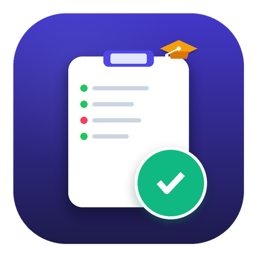

<p align="center">
  
</p>

<h1 align="center">📋 Attendance Master</h1>

<p align="center">
  <strong>Modern, extremely user-friendly Android attendance tracking application</strong><br />
  Built with Jetpack Compose, Material 3, SQLite & Firebase Firestore
</p>

---

## ✨ Features

- ⚡ **One-Tap Fast Attendance**: Tap any student card to toggle between **Present** (Emerald Green) and **Absent** (Rose Red) with smooth animated feedback.
- 🎓 **Categorized Tracking**: Support for categories (e.g. **GATE** vs. **NON-GATE**, Day Scholar vs. Hosteller, or Section A vs. B) with distinct badges.
- 🔄 **Multiple Sessions Per Day**: Take attendance as many times as needed throughout the day (Session 1, Session 2, Lab, etc.).
- ⏱️ **Late Comers & Session Editing**: Anyone arrives late? Simply open any past session from the logs, mark late arrivals present with a single tap, and update the session with a dedicated `⏱️ LATE` tag.
- 📋 **Teacher WhatsApp / SMS Share**:
  - One-tap **Copy Message** button with clear GATE/Non-GATE breakdown, checkmarks, total summary, and absentees roll numbers.
  - 3 format options:
    1. **Full Structured Report** (Detailed list with icons & sections)
    2. **Absentees Only** (Fast summary of absent roll numbers & names)
    3. **Roll Numbers Only** (Plain comma-separated list)
- 📥 **Paste & Bulk Import Roster**: Copy your student list directly from Excel, Google Sheets, or WhatsApp and paste it into the app — the smart parser sets up your entire class in 2 seconds!
- 🔤 **Initial Names Converter**: Convert full official names into clean initial format (`ALEX CARTER` → `A. CARTER`) with one click in Settings.
- 📊 **Attendance Analytics**:
  - Class average percentage.
  - Category breakdown comparison.
  - Automated warning flags for students below the **75% minimum attendance target**.
- ☁️ **Offline-First + Firebase Sync**:
  - Fully functional offline using a local SQLite database (zero crashes, 100% reliable).
  - Optional cloud backup and synchronization to Firebase Firestore.
- 📤 **Export & Backup**: Export attendance history to CSV (Excel / Google Sheets compatible) or JSON.

---

## 📸 WhatsApp Report Example

```text
📋 *ATTENDANCE REPORT*
📅 Date: 2026-11-17 | ⏰ 09:30 AM
🏷️ Session: Session 1
━━━━━━━━━━━━━━━━━━━
📊 Summary: *4/5 Present* (1 Absent)
• GATE: 2/2 Present
• NON-GATE: 2/3 Present
━━━━━━━━━━━━━━━━━━━

🎓 *GATE STUDENTS* (2/2):
✅ 101 - A. CARTER (Present)
✅ 102 - E. DAVIS (Present)

📚 *NON-GATE STUDENTS* (2/3):
✅ 103 - L. JOHNSON (Present)
✅ 104 - S. WILLIAMS (Present)
❌ 105 - N. BROWN (ABSENT)

━━━━━━━━━━━━━━━━━━━
🚨 *ABSENTEES LIST (1):*
• [NON-GATE] 105 - N. BROWN

📌 *Absentees Roll Nos:* 105
```

---

## 🛠️ Tech Stack

- **UI**: Jetpack Compose, Material 3, Compose Animations
- **Architecture**: MVVM (Model-View-ViewModel), StateFlow, Coroutines
- **Local Database**: Native Android SQLite (`SQLiteOpenHelper`)
- **Backend / Cloud**: Google Cloud Firestore REST / Firebase Sync
- **Language**: Kotlin 2.2+
- **Build System**: Gradle 9.6, AGP 9.5

---

## 🚀 Getting Started

### 1. Clone the Repository
```bash
git clone https://github.com/your-username/attendance-master.git
cd attendance-master
```

### 2. Build and Run
Open the project in **Android Studio** and click **Run**, or build using the Gradle wrapper:

```bash
# Debug APK
./gradlew assembleDebug

# Run Unit Tests
./gradlew testDebugUnitTest
```

The compiled APK will be at `app/build/outputs/apk/debug/app-debug.apk`.

---

## 📄 License
This project is open-source under the [MIT License](LICENSE).
